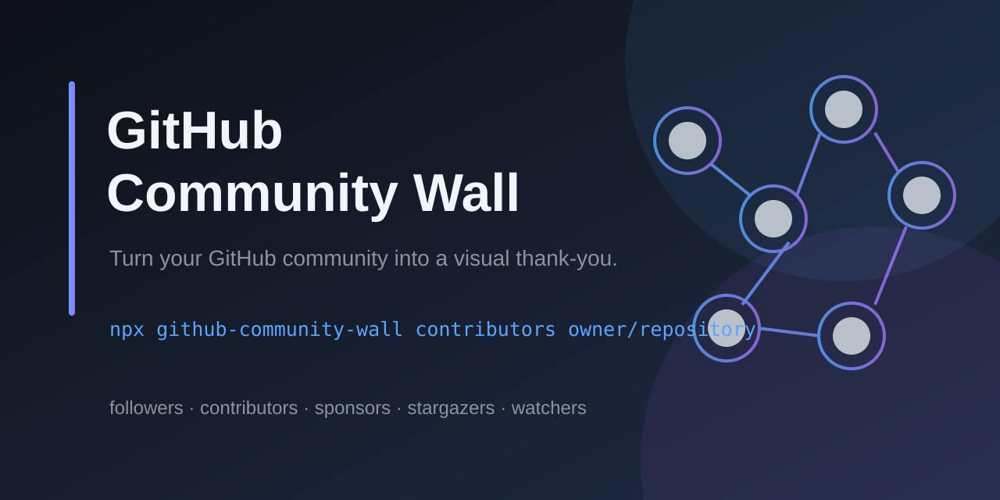

# github-community-wall

[](https://github.com/ale0aranda/github-community-wall/actions/workflows/ci.yml)
[](https://github.com/ale0aranda/github-community-wall/actions/workflows/codeql.yml)
[](https://www.npmjs.com/package/github-community-wall)
[](https://www.npmjs.com/package/github-community-wall)
[](LICENSE)

Generate polished, ready-to-publish community walls from GitHub data. Turn the
people around a project into a visual thank-you for a README, website, release
post, or social banner.




Generate a wall locally:

```sh
npx github-community-wall contributors owner/repository \
  --output community-wall.png \
  --theme github-dark \
  --limit 100
```

## Why this project

`github-community-wall` handles the repetitive parts of making a community
wall: fetching paginated GitHub data, filtering useful accounts, downloading
avatars reliably, rendering a consistent layout, and writing the result to a
file. It is designed for both one-off exports and automated README updates.

**Highlights**

- Followers, contributors, sponsors, stargazers, watchers, and organization members.
- PNG, JPEG, WebP, SVG, standalone HTML, and JSON metadata output.
- Themes, titles, subtitles, watermarks, avatar shapes, filters, and sorting.
- Local caching, offline regeneration, `doctor` diagnostics, and dry runs.
- A typed library API in addition to the CLI.

## Install

```sh
npm install -g github-community-wall
# or
pnpm add github-community-wall
```

The CLI requires Node.js 22.13 or newer. For a one-off run, use `npx
github-community-wall ...`.

## Authentication

Set a GitHub token in the environment:

```sh
export GITHUB_TOKEN=github_pat_...
```

For public followers, contributors, stargazers, and watchers, a fine-grained
token with read-only public repository access is enough. Sponsors require access
to the authenticated maintainer's sponsorship data. You can also pass
`--github-token`, but environment variables are safer because the token will
not appear in shell history or the process list.

## Quick start

```sh
# Generate a wall for the authenticated user's followers
github-community-wall followers --output assets/followers.png
```

Pass a username, repository, or organization when the source is not the
authenticated account:

```sh
github-community-wall contributors owner/repository --limit 100
github-community-wall sponsors owner --background "#0d1117"
github-community-wall stargazers owner/repository
github-community-wall watchers owner/repository
github-community-wall members organization
```

Run `github-community-wall --help` or
`github-community-wall <command> --help` for every option.

## Publishing and automation

Update a README in one command. The command replaces the block between stable
markers or appends it when the markers do not exist:

```sh
github-community-wall readme contributors owner/repository \
  --output assets/contributors.png \
  --theme github-dark \
  --watermark "Built by the community"
```

```md
<!-- community-wall:start -->
<!-- community-wall:end -->
```

For scheduled updates, grant the workflow `contents: write` and use the
repository token:

```yaml
- uses: actions/checkout@v4
- uses: actions/setup-node@v4
  with:
    node-version: 22
- run: npx github-community-wall contributors "$GITHUB_REPOSITORY" \
    --output assets/contributors.png
  env:
    GITHUB_TOKEN: ${{ github.token }}
```

You can also run the package directly in a workflow:

```yaml
name: Update community wall

on:
  schedule:
    - cron: "0 6 * * *"
  workflow_dispatch:

permissions:
  contents: write

jobs:
  wall:
    runs-on: ubuntu-latest
    steps:
      - uses: actions/checkout@v4
      - uses: actions/setup-node@v4
        with:
          node-version: 22
      - run: npx github-community-wall contributors "$GITHUB_REPOSITORY" --output assets/contributors.png
        env:
          GITHUB_TOKEN: ${{ github.token }}
      - uses: EndBug/add-and-commit@v9
        with:
          message: "chore: update community wall"
          add: assets/contributors.png
```

The repository includes a ready-to-use scheduled workflow in
`.github/workflows/update-community-wall.yml`.

The `--twitter-banner` option produces a 1500x500 banner for followers:

```sh
github-community-wall followers owner --twitter-banner \
  --output assets/followers-banner.png
```

## Configuration file

Commands can read defaults from `.community-wall.json` in the current directory:

```json
{
  "imageSize": 64,
  "columns": 10,
  "limit": 100,
  "background": "#0d1117",
  "gap": 2,
  "shape": "circle",
  "output": "assets/community-wall.png",
  "format": "png",
  "excludeBots": true,
  "sort": "login",
  "filterType": "user",
  "includeLoginPattern": "^(alice|bob)$",
  "minContributions": 10,
  "minFollowers": 50
}
```

Use another file with `--config path/to/wall.json`. Command-line options always
override configuration values. `config init` creates a starter file and
`doctor` validates the configuration and GitHub token without printing it:

```sh
github-community-wall config init
github-community-wall doctor
github-community-wall doctor --json
```

## Output and filtering

PNG is the default output format. Select `png|jpeg|webp|svg|html|json` with
`--format`, or infer it from a `.png`, `.jpg`, `.jpeg`, `.svg`, `.webp`, `.html`,
or `.json` output path. HTML is standalone and JSON contains avatar metadata
and layout information.

```sh
# Only regular users matching a pattern
github-community-wall followers octocat \
  --filter-type user \
  --include-login '^(alice|bob)$'

# Keep only active contributors
github-community-wall contributors owner/repository \
  --min-contributions 10 \
  --max-contributions 200 \
  --sort contributions

# Only include followers with a meaningful audience
github-community-wall followers octocat \
  --min-followers 100 \
  --max-followers 5000
```

The renderer supports configurable backgrounds, gaps, circular or square
avatars, titles, subtitles, themes, and watermarks. `--dry-run --json` inspects
the resolved input without writing an image. Contributors exclude bots by
default; sources omit accounts without an avatar URL.

## Library API

The package also exports the fetchers, renderer, GitHub error classes, and
TypeScript types:

```ts
import {
  createGitHubHeaders,
  fetchFollowersPfps,
  renderAvatarGrid
} from 'github-community-wall';

const headers = createGitHubHeaders(process.env.GITHUB_TOKEN!);
const avatars = await fetchFollowersPfps('octocat', headers, 50);
const png = await renderAvatarGrid(avatars, {
  columns: 10,
  imageSize: 64
});
```

See the generated declarations in `dist/index.d.ts` for the complete typed API.

## CLI reference

```sh
github-community-wall --help
github-community-wall followers --help
github-community-wall contributors --help
github-community-wall doctor --help
```

The CLI supports GitHub followers, contributors, sponsors, stargazers,
watchers, and organization members. Use `--json` or `--dry-run --json` when
integrating it into scripts and CI.

## Contributing

Contributions are welcome, especially improvements to output quality, GitHub
API resilience, documentation, and tests. Start with
[CONTRIBUTING.md](CONTRIBUTING.md), search existing issues, and open a focused
issue before large changes. Pull requests should include tests for behavior
changes and keep the public CLI documentation in sync.

## Support and security

For bugs and feature proposals, use the
[issue tracker](https://github.com/ale0aranda/github-community-wall/issues).
For token leaks or other security vulnerabilities, follow
[SECURITY.md](SECURITY.md) instead of opening a public issue. Please also read
the [Code of Conduct](CODE_OF_CONDUCT.md).

## License

MIT
